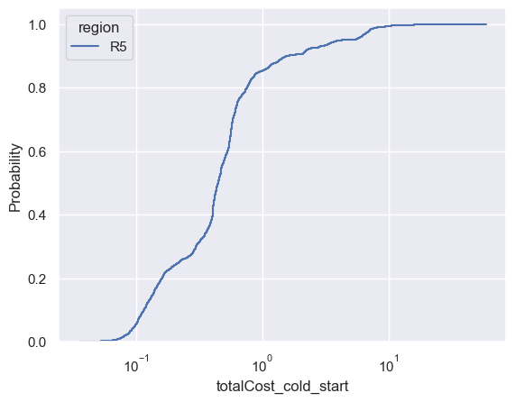

# Демо

Для технической проверки запуска используется первый раздел авторского notebook
на одном произвольно выбранном наборе данных.

## Запуск демо

Предварительно установите Conda, например [Miniforge](https://github.com/conda-forge/miniforge#install).
Также нужны Git, Bash, curl и unzip. Под репозиторием далее понимается
командный [dmitryseb/nis-project-p19](https://github.com/dmitryseb/nis-project-p19).
В нём уже находятся скрипт, описание окружения и копия авторского notebook;
отдельно клонировать репозиторий авторов для этого запуска не требуется.

Запуск из корня `nis-project-p19`:

```bash
bash scripts/run_demo.sh
```

Скрипт можно вызвать и по абсолютному пути из другого рабочего каталога.
Все пути он определяет относительно своего расположения.

Последовательно выполняются:

1. Создание Conda-окружения в `.conda/` из `environment.yml`, если Python в нём ещё отсутствует.
2. Проверка наличия непустых файлов демо за дни 00–30. Если они уже есть, скачивание и распаковка пропускаются.
3. Если CSV не хватает, используется существующий `data/raw/R5.zip`; при отсутствии архива он скачивается с Google Drive авторов и распаковывается.
4. Выполнение первых четырёх кодовых ячеек полного авторского notebook: импорты, настройка региона и путей, чтение CSV и построение графика.
5. Расчёт численной сводки, сохранение графика и выводов notebook.

После успешного выполнения выводится сводка и список сохранённых файлов. Результаты первых четырёх
авторских ячеек сохраняются в `src/demo_cold_start.ipynb`.
В `results/demo/` обновляются `cold-start-cdf.png` и `summary.json`.

## Ручная загрузка данных

Если автоматическое скачивание не удалось, то стоит попробовать скачать архив вручную:

1. Откройте [архив данных демо на Google Drive авторов](https://drive.google.com/file/d/1ah7nj5fyedMpOeaFgNVA7oMx3815D8BZ/view) и скачайте архив через браузер.
2. Создайте папку `data/raw` внутри `nis-project-p19` и сохраните туда архив с именем `R5.zip`
3. Повторите из корня репозитория:

```bash
bash scripts/run_demo.sh
```

Распаковывать архив вручную не нужно: скрипт найдёт его, пропустит скачивание
и сам положит CSV в нужный каталог. Для восстановления удалённого CSV также
достаточно оставить архив на этом месте.

## Ожидаемые результаты

Если скрипт отработает успешно, он сохранит посчитанные метрики в `results/demo/summary.json`
(файл создаётся при запуске и в репозиторий не входит) и выведет их в терминал.
При успешном запуске они должны совпадать с ожидаемыми:

| Показатель | Значение |
|---|---:|
| CSV | 31 |
| События | 805 745 |
| Дни | 0–30 |
| Пропуски общей длительности | 0 |
| Отрицательные общие длительности | 0 |
| Медиана, с | 0.447381 |
| p95, с | 4.192305 |

Также скрипт сохраняет график распределения длительности холодного старта. При успешном срабатывании скрипта он должен выглядеть так: 

X — длительность в секундах, логарифмическая шкала; Y — накопленная доля
холодных событий. Используется авторская гистограмма с 500 интервалами.
